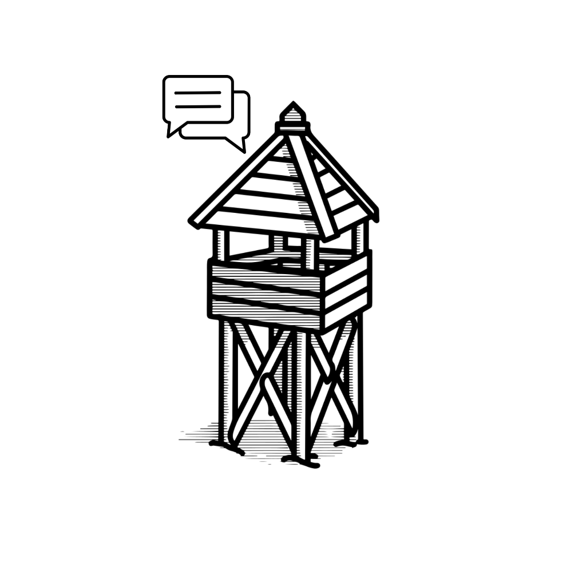

<div align="center">
  
</div>

# 🛡️ OUTPOST BETA v3.1

<a href="https://outpost-app-a0c.pages.dev">
  
</a>

**A sovereign, hyper-fast, and highly-secure communication platform designed to redefine how technical teams and gaming squads deploy basecamps and manage perimeters.**

[](https://outpost-app-a0c.pages.dev)
[](https://outpost-app.onrender.com)
[](https://github.com/Harshit-Mehta-Dev/OUTPOST-APP)

> 📘 **Full Technical & Feature Documentation:** See [OUTPOST_MASTER_DOCUMENTATION.md](./OUTPOST_MASTER_DOCUMENTATION.md) for the exhaustive specification covering all features, database schemas, and architectural diagrams.

---

## 🌐 Overview

**Outpost** was forged out of a simple, uncompromised necessity: communication tools should be fast, unburdened by bloat, and highly secure. It provides communities with customizable "Campsites" containing nested channels for text and media sharing, powered by a high-performance WebSockets engine.

## ✨ Core Functionalities

*   **⚡ Real-Time WebSockets Engine:** Zero-latency messaging, live presence tracking, and active typing indicators.
*   **🎨 Dynamic Theming Matrix:** Real-time CSS variable injection allows users to instantly swap between custom colorways (e.g., Cyber Pulse, Emerald Solid, Slate Khaki).
*   **🛡️ Role-Based Access Control (RBAC):** Military-grade permission hierarchies separating *Commanders* (Admins) and *Scouts* (Members).
*   **🎮 XP & Leveling Progression:** Gamified engagement engine that rewards users with XP for activity, unlocking new visual ranks.
*   **🤖 AI Basecamp Ranger:** An optional automated toxicity filter that silently evaluates and intercepts malicious transmissions in real-time.
*   **📊 Interactive Polls & Media:** Built-in polling logic and on-the-fly media compression for image sharing.
*   **🔔 Tactical OS Notifications:** Native desktop hardware push notifications integrated with the browser's Notification API.
*   **📱 Glassmorphism UI:** A stunning, fully responsive tactical interface built with modern CSS standards.

---

## 🛠️ Technical Stack

### Frontend Architecture
*   **Core:** React 18, Vite (Bundler)
*   **Styling:** Vanilla CSS (Glassmorphism, CSS Variables, Flexbox/Grid)
*   **Real-time Client:** `socket.io-client`
*   **Icons & Assets:** `lucide-react`
*   **Animations:** `framer-motion`
*   **Markdown:** `react-markdown`

### Backend Architecture
*   **Runtime Engine:** Node.js
*   **Framework:** Express.js
*   **Real-time Server:** `socket.io`
*   **Database:** MongoDB via Mongoose ODM
*   **Security layer:** `helmet`, `xss-clean`, `express-rate-limit`, `cors`
*   **Compression:** Compression Middleware, Brotli/Gzip

### DevOps & Infrastructure
*   **Frontend Hosting:** Cloudflare Pages (Global CDN)
*   **Backend Hosting:** Render (Web Service)
*   **Database Hosting:** MongoDB Atlas (Cloud Cluster)
*   **Version Control:** Git / GitHub
*   **SEO Indexing:** Google Search Console (XML Sitemaps)

---

## 📂 Detailed Architecture Tree

```text
OUTPOST-APP/
│
├── src/                          # FRONTEND CLIENT ARCHITECTURE
│   ├── assets/                   # Static media (logos, banners, backgrounds)
│   ├── components/               # Modular React UI Components
│   │   ├── chat/                 # Chat interface modules (Attachment popovers)
│   │   ├── dashboard/            # Telemetry and telemetry grids
│   │   ├── landing/              # Public-facing landing page sections
│   │   ├── navigation/           # Sidebar, Header, and Notification dropdowns
│   │   └── settings/             # User settings and AI Guard controls
│   ├── context/                  # Global React State (ThemeContext)
│   ├── hooks/                    # Custom lifecycle hooks (useSignalRadar, useSound)
│   ├── pages/                    # Core layout wrappers (Landing, Basecamp, Auth)
│   ├── App.jsx                   # Primary Router and App Injector
│   └── index.css                 # Global Design System & CSS Variable Tokens
│
├── server/                       # BACKEND SERVER ARCHITECTURE
│   ├── models/                   # MongoDB Mongoose Schemas (User, Message, Campsite)
│   ├── routes/                   # Express REST API Endpoints
│   ├── utils/                    # Data processing utilities (Compression, RBAC checks)
│   └── server.js                 # Primary Express App & Socket.io WebSockets Engine
│
├── public/                       # Publicly exposed static files
│   ├── sitemap.xml               # SEO Web Crawler Map
│   └── robots.txt                # Search Engine Bot configuration
│
├── index.html                    # Root HTML Document & Meta tags
├── package.json                  # Node.js Dependencies & Build Scripts
└── vite.config.js                # Vite Bundler Configuration
```

---

## 🚀 Deployment Operations

To spin up a local development instance of Outpost:

1. **Clone the repository:**
   ```bash
   git clone https://github.com/Harshit-Mehta-Dev/OUTPOST-APP.git
   ```
2. **Install Dependencies:**
   ```bash
   npm install
   ```
3. **Launch Local Server:**
   ```bash
   npm run dev
   ```

*To deploy to production, verify your environment variables and execute `npm run deploy` to push the build directory to your Cloudflare/Render pipelines.*

<div align="center">
  <br>
  
</div>
<!-- Achievement Unlocked -->