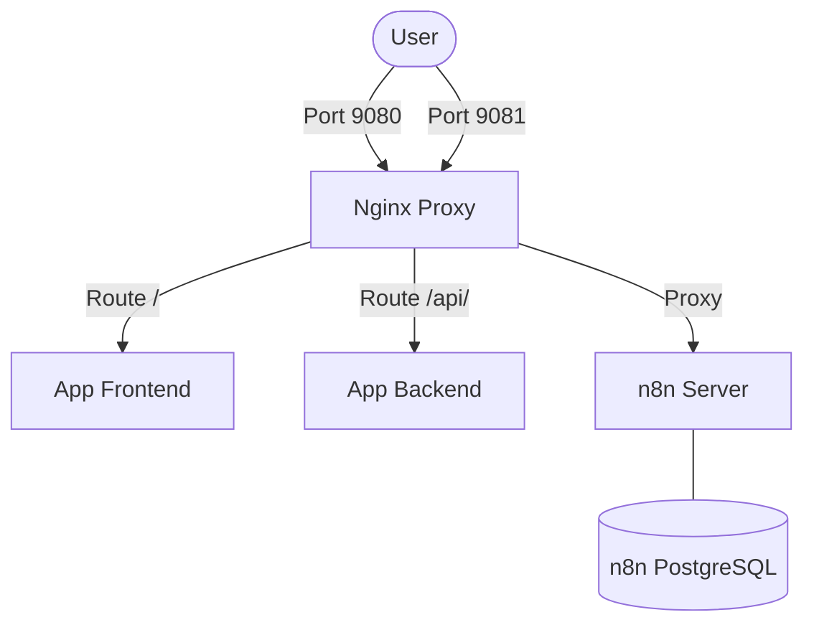

# n8n Secure Setup Guide

This guide explains the architecture of the n8n automation setup integrated into your application stack and how you can manage it.

## Architecture Overview

We have integrated n8n as a dedicated, fully-isolated automation system. It runs alongside your application but on a completely separate port (`8081`) to guarantee security and separation of concerns. 

Here is how the services are structured:

1. **Frontend & Backend (Your App):** Runs on port `9080` (handled by Nginx).
2. **n8n Automation Server:** Runs internally on port `5678` and is securely exposed by Nginx on **Port 9081** (`http://localhost:9081`).
3. **n8n Database (PostgreSQL):** A dedicated PostgreSQL 16 database running internally (port `5432`) that only n8n can access. This ensures your workflows and execution data are robust, scalable, and safe from corruption.



## Security Measures

To fulfill the requirement of "safe and secure, no vulnerabilities":
- **Port Isolation:** n8n is isolated on port `9081` to separate automation administration traffic from normal user traffic on port `9080`.
- **User Management Enforcement:** `N8N_ENFORCEMENT_USER_MANAGEMENT=true` is enabled. The first time you visit `http://localhost:9081`, you will be forced to create an Owner account. Nobody can access the dashboard without logging in.
- **Dedicated Database:** Storing credentials and execution history in a dedicated PostgreSQL database limits the blast radius if your main app database is compromised.
- **Strict Headers:** The Nginx proxy block for n8n includes `nosniff`, `X-Frame-Options: DENY`, and strict Permissions-Policy to prevent XSS and Clickjacking attacks.

## Getting Started

1. **Start the Stack:**
   Run the following command from the root of your project:
   ```bash
   docker-compose up -d n8n n8n-db nginx
   ```
   *Note: This will download the n8n and PostgreSQL images and start them.*

2. **Access the Dashboard:**
   Open your browser and navigate to:
   `http://localhost:9081/`

3. **Set Up the Owner Account:**
   Because user management is enforced, n8n will immediately prompt you to set up an admin email and password. Store these credentials safely.

## How to Connect n8n to Your App

To sync your automation with your application backend:

### Triggering n8n from your App
You can create a **Webhook trigger** in n8n. 
1. In n8n, add a "Webhook" node.
2. Select "POST" as the method.
3. n8n will give you a Webhook URL (e.g., `http://localhost:9081/webhook/your-id`).
4. In your Node.js backend, send an HTTP POST request to that URL whenever an event happens (e.g., a new user registers).

### Triggering your App from n8n
If n8n needs to tell your backend to do something (like updating a database record after an automated email is sent):
1. Use the **HTTP Request** node in n8n.
2. Set the URL to your internal backend service (e.g., `http://backend:10000/api/some-endpoint`). 
   *Note: Because they share the `outpost-network`, n8n can securely call your backend internally using the hostname `backend`.*

## Data Persistence

Your workflows, credentials, and settings are saved in Docker volumes:
- `n8n_data`: Contains encryption keys and n8n configurations.
- `n8n_db_data`: The PostgreSQL data containing all your workflows and execution history.

Even if you destroy the containers, your automation setup will persist as long as the volumes are kept intact.
